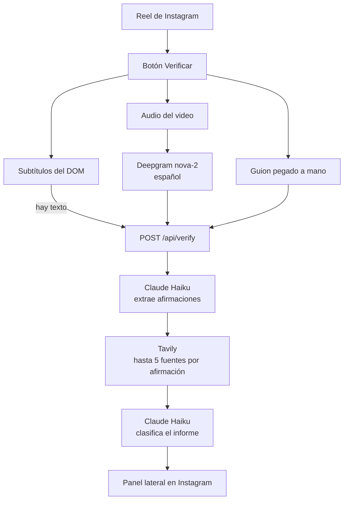

# Truth Tracker

Extensión de Chrome para verificar el guion de un Reel de Instagram. La persona activa la verificación, el guion sale del reel y un informe marca qué está bien sustentado, qué no, y qué medidas se proponen.

El producto vive en `todo/`: el backend Next.js y la extensión Manifest V3. `goal.md` y `spec.md` guardan el objetivo y el detalle.

## Cómo circula la información



1. La persona está en un Reel y pulsa **Verificar**, en el botón flotante o en el popup de la extensión.
2. La extensión busca subtítulos en la página. Si no hay, toma el audio del video. Si eso también falla, la persona pega el guion.
3. El texto entra directo a `POST /api/verify`. El audio entra en base64 y Deepgram lo transcribe antes de seguir.
4. Claude Haiku saca las afirmaciones del guion.
5. Tavily busca en la web, una consulta por afirmación.
6. Claude Haiku, en una segunda llamada, arma el informe con esas afirmaciones y las fuentes.
7. La extensión abre el panel lateral dentro de Instagram.

## Modelos

| Paso | Servicio | Modelo |
| --- | --- | --- |
| Transcribir el audio | Deepgram | `nova-2`, idioma `es` |
| Extraer afirmaciones | Anthropic | `claude-3-5-haiku-latest` |
| Buscar fuentes | Tavily | búsqueda `basic`, máximo 5 resultados |
| Clasificar el informe | Anthropic | `claude-3-5-haiku-latest` |

Haiku se usa dos veces: primero para la lista de afirmaciones y después para el informe. El modelo se puede cambiar con `ANTHROPIC_MODEL`. Tavily no es un modelo de lenguaje: solo devuelve páginas.

El informe tiene cinco bloques: información correcta, información falsa, sin evidencia suficiente, información selectiva y análisis de las medidas propuestas.

## Cómo correrlo

En `todo/`:

```bash
npm install
copy .env.example .env.local
npm run dev
npm run build:extension
```

`.env.local` necesita `ANTHROPIC_API_KEY`, `TAVILY_API_KEY` y `DEEPGRAM_API_KEY`.

En Chrome, abre `chrome://extensions`, activa el modo de desarrollador y carga la carpeta `todo/extension`.

```bash
npm test
```
