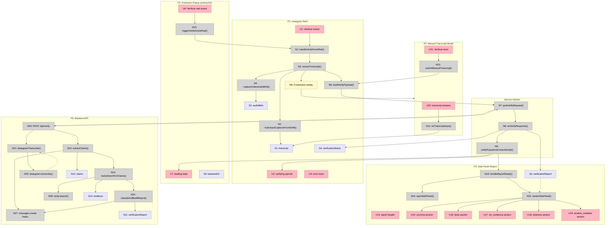

---

## shaping: true

# Truth Tracker — Breadboard (Shape A)

**Shape:** A — Chrome extension + Next.js verification pipeline  
**Workflow:** Usuario en un reel de Instagram → activa verificación → informe completo en panel lateral (sin popup de resumen)  
**Related:** [shaping.md](shaping.md) · [goal.md](goal.md) · [visual-style-reference.md](visual-style-reference.md)

**🟡 Sync 2026-08-01:** Alineado con `goal.md` — eliminado popup de resumen; el informe se muestra directamente en el panel lateral.

**Shape parts covered:** A1–A8

---

## Workflow Guide

| Step  | Action                               | Where to look              |
| ----- | ------------------------------------ | -------------------------- |
| **1** | Click "Verificar" (flotante o popup) | U1 / U6 → N1 / N10 → N2    |
| **2** | Extraer guión (captions → audio)     | N2 → N3 / N4 → S1          |
| **3** | Si falla extracción, pegar guión     | N5 → P4 → U20 → S1         |
| **4** | Enviar al backend                    | N6 → N7 → P5               |
| **5** | Pipeline STT + Tavily + Haiku        | N20–N27                    |
| **6** | 🟡 Abrir panel lateral con informe   | N8 → S3 → N18 → N14 → N15  |
| **7** | Leer informe completo                | S3 → U14–U19               |

---

## Places

| #   | Place                   | Description                                                      | Shape part |
| --- | ----------------------- | ---------------------------------------------------------------- | ---------- |
| P1  | Instagram Reel          | Usuario scrollea reels; botón flotante visible en reel activo    | A3.1       |
| P2  | Extension Popup         | 🟡 Popup MV3: activar verificación, config backend, loading/error (sin informe) | A1, A7     |
| P3  | Side Panel (Report)     | 🟡 Panel lateral en Instagram; informe completo al terminar verificación        | A8         |
| P4  | Manual Transcript Modal | Modal bloqueante cuando falla extracción automática              | A2.4       |
| P5  | Backend API             | Next.js `todo/` — orquestación y APIs externas                   | A4–A6      |

---

## UI Affordances

| #   | Place | Component       | Affordance                        | Control        | Wires Out  | Returns To |
| --- | ----- | --------------- | --------------------------------- | -------------- | ---------- | ---------- |
| U1  | P1    | reel-overlay    | "Verificar" floating button       | click          | → N1       | —          |
| U2  | P1    | reel-overlay    | verifying spinner on button       | render         | —          | —          |
| U3  | P1    | reel-overlay    | extraction error toast            | render         | —          | —          |
| U4  | P2    | extension-popup | popup header (pink glow gradient) | render         | —          | —          |
| U5  | P2    | extension-popup | backend URL config input          | type           | → N30      | —          |
| U6  | P2    | extension-popup | "Verificar reel actual" button    | click          | → N10      | —          |
| U7  | P2    | extension-popup | loading state                     | render         | —          | —          |
| U14 | P3    | side-panel      | panel header + close button       | render / click | close → P1 | —          |
| U15 | P3    | side-panel      | `correcta` section + source links | render         | —          | —          |
| U16 | P3    | side-panel      | `falsa` section + source links    | render         | —          | —          |
| U17 | P3    | side-panel      | `sin_evidencia` section           | render         | —          | —          |
| U18 | P3    | side-panel      | `selectiva` (Sí/No + explicación) | render         | —          | —          |
| U19 | P3    | side-panel      | `analisis_medidas` section        | render         | —          | —          |
| U20 | P4    | manual-modal    | transcript textarea               | type           | → N12      | —          |
| U21 | P4    | manual-modal    | "Verificar texto" button          | click          | → N13      | —          |
| U22 | P4    | manual-modal    | cancel button                     | click          | → P1       | —          |

---

## Code Affordances

| #   | Place | Component        | Affordance                                 | Control     | Wires Out            | Returns To   |
| --- | ----- | ---------------- | ------------------------------------------ | ----------- | -------------------- | ------------ |
| N1  | P1    | content-script   | `handleVerifyFromReel()`                   | call        | → N2                 | —            |
| N2  | P1    | content-script   | `extractTranscript()`                      | call        | → N3, → N4, → N5     | —            |
| N3  | P1    | content-script   | `~tryExtractCaptionsFromDOM()`             | call        | → S1                 | → N2         |
| N4  | P1    | content-script   | `~captureVideoAudioBlob()`                 | call        | → S2                 | → N2         |
| N5  | P1    | content-script   | if extraction empty                        | conditional | → P4                 | —            |
| N6  | P1    | content-script   | `buildVerifyPayload()`                     | call        | → N7                 | —            |
| N7  | P1    | service-worker   | `postVerifyRequest()`                      | call        | → N20                | → N8         |
| N8  | P1    | service-worker   | `onVerifyResponse()`                       | receive     | → S3, → S4, → N9     | —            |
| N9  | P1    | service-worker   | `notifyUiAndOpenPanel()`                   | call        | → U2, → U7, → N18    | —            |
| N10 | P2    | extension-popup  | `triggerVerifyActiveReel()`                | call        | → N1                 | —            |
| N12 | P4    | manual-modal     | `onTranscriptInput()`                      | input       | → S1                 | —            |
| N13 | P4    | manual-modal     | `submitManualTranscript()`                 | call        | → N6, → P1           | —            |
| N14 | P3    | content-script   | `openSidePanel()`                          | call        | → P3                 | —            |
| N15 | P3    | content-script   | `renderSidePanel(report)`                  | call        | → U14–U19            | —            |
| N16 | P3    | content-script   | `closeSidePanel()`                         | call        | → P1                 | —            |
| N18 | P1    | content-script   | `handleReportReady()`                      | receive     | → N14, → N15         | —            |
| N30 | P2    | extension-popup  | `saveBackendUrl()`                         | call        | → S5                 | —            |
| N20 | P5    | verify-route     | `POST /api/verify` handler                 | receive     | → N21, → N22         | → N7         |
| N21 | P5    | verify-route     | if `audioBlob`: `deepgramTranscribe()`     | conditional | → S10                | → N22        |
| N22 | P5    | verify-route     | `extractClaims(transcript)`                | call        | → S12                | → N23        |
| N23 | P5    | verify-route     | `tavilySearchForClaims(claims)`            | call        | → S13                | → N24        |
| N24 | P5    | verify-route     | `classifyAndBuildReport(claims, evidence)` | call        | → S11                | → N20        |
| N25 | P5    | deepgram-client  | `deepgram.transcribe()`                    | call        | → S20                | → N21        |
| N26 | P5    | tavily-client    | `tavily.search()`                          | call        | → S21                | → N23        |
| N27 | P5    | anthropic-client | `messages.create()` (Haiku)                | call        | → S22                | → N22, → N24 |

---

## Data Stores

| #   | Place | Store                | Description                                      | Written by      | Read by          |
| --- | ----- | -------------------- | ------------------------------------------------ | --------------- | ---------------- |
| S1  | P1    | `transcript`         | Texto del guión (captions, STT remoto, o manual) | N3, N12, N21→N8 | N6               |
| S2  | P1    | `audioBlob`          | Audio capturado del `<video>`                    | N4              | N6, N21          |
| S3  | P3    | 🟡 `verificationReport` | JSON informe completo                            | N8              | N15, U14–U19     |
| S4  | P1    | `verificationStatus`      | `idle` \| `extracting` \| `verifying` \| `error`   | N1, N8          | U2, U7, U3       |
| S5  | P2    | `backendUrl`         | URL base del backend (`http://localhost:3000`)   | N30             | N7               |
| S10 | P5    | `transcript`         | Transcript normalizado en request                | N21, N20        | N22              |
| S11 | P5    | `verificationReport` | Respuesta JSON del pipeline                      | N24             | N20              |
| S12 | P5    | `claims[]`           | Afirmaciones extraídas del guión                 | N22             | N23, N24         |
| S13 | P5    | `evidence[]`         | Resultados Tavily por afirmación                 | N23             | N24              |
| S20 | P5    | Deepgram API         | Servicio STT externo                             | —               | N25              |
| S21 | P5    | Tavily API           | Servicio búsqueda externo                        | —               | N26              |
| S22 | P5    | Anthropic API        | Claude Haiku externo                             | —               | N27              |

---

## Shape A → Affordance mapping

| Part | Mechanism           | Affordances                            |
| ---- | ------------------- | -------------------------------------- |
| A1   | Extension shell MV3        | U4–U7, N7–N10, N18, N30, S5           |
| A2   | Script extraction          | N2–N5, N3, N4, U20–U22, P4, S1, S2 (spike A2 resuelto → `spike-instagram-extraction.md`) |
| A3   | Activation                 | U1, U6, N1, N10                       |
| A4   | Verification API           | N20–N24, S10–S13, S11                 |
| A5   | STT Deepgram               | N21, N25, S20                         |
| A6   | Search + analysis          | N22–N24, N26–N27, S21–S22             |
| A7   | 🟡 Popup activación + config | U4–U7, N10, N30, S5                 |
| A8   | 🟡 Side panel informe      | P3, U14–U19, N14–N16, S3              |

**Spike A2 resuelto:** N3 `tryExtractCaptionsFromDOM` (heurística DOM/aria; frágil) y N4 captura de audio vía `tabCapture` + offscreen (no `video.captureStream` como primaria). Detalle y pasos V4 en `spike-instagram-extraction.md`.

---

## Wiring Diagram

---

## Slice preview (implementation order)

Cada slice termina en UI demo-able.

| #   | Slice                          | Mechanism                            | Affordances                            | Demo                                         |
| --- | ------------------------------ | ------------------------------------ | -------------------------------------- | -------------------------------------------- |
| V1  | Manual verify path             | A2.4 + A4 + A8 (sin extracción auto) | P4, U20–U21, N13, N20–N24, P3, U15–U19 | Pegar guión San Miguel → panel con informe   |
| V2  | Backend pipeline only          | A4–A6                                | N20–N27, S10–S13                       | `curl POST /api/verify` devuelve JSON válido |
| V3  | 🟡 Panel opens on verify complete | A8 + A1 messaging                    | N8–N9, N18, N14–N15, P3, U14–U19       | Verificar → panel lateral se abre solo     |
| V4  | Floating button + auto extract    | A2 + A3                              | P1, U1–U3, N1–N6, N3, N4               | Click flotante en reel → panel con informe |
| V5  | 🟡 Full flow + polish             | A7 + A8 estilo                       | U4, U14, visual-style-reference        | Flujo completo con Soft Atelier Glow       |

**Nota:** V1 desbloquea R0, R2, R3, R6 sin depender del spike A2. V4 depende de resolver N3/N4.

---

## Open questions

| #   | Question                                                                                           | Blocks         |
| --- | -------------------------------------------------------------------------------------------------- | -------------- |
| Q1  | ¿Popup permanece abierto durante verificación (~90 s) mostrando solo loading, o se cierra y el panel notifica? | U7, N9         |
| Q2  | ¿Side panel bloquea interacción con el reel (Place) o es semi-transparente overlay?                             | P3 containment |
| Q3  | ✅ `chrome.storage.session` para S3 (`verificationReport`) entre service worker y content script                 | N8, N18, N15   |

---

## Verification checks

| Check                               | Status                        |
| ----------------------------------- | ----------------------------- |
| Every display U has data source     | ✅ S3 → U14–U19 via N15        |
| Every N has Wires Out or Returns To | ✅                             |
| Navigation wires to Places          | ✅ N5 → P4, N14 → P3, N18 → P3 |
| Backend modeled as Place            | ✅ P5                          |
| Speculative affordances marked      | ✅ N3, N4 with `~`             |
| Tables are source of truth          | ✅ Diagram derived from tables |

